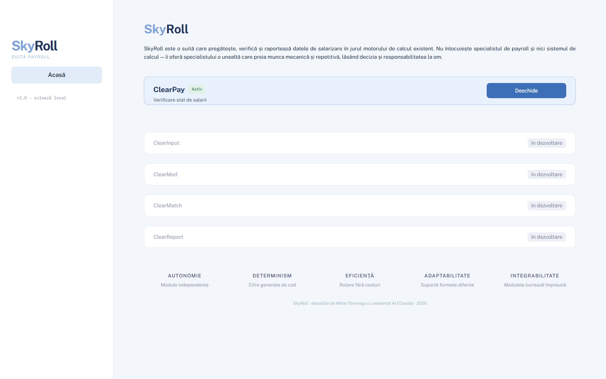
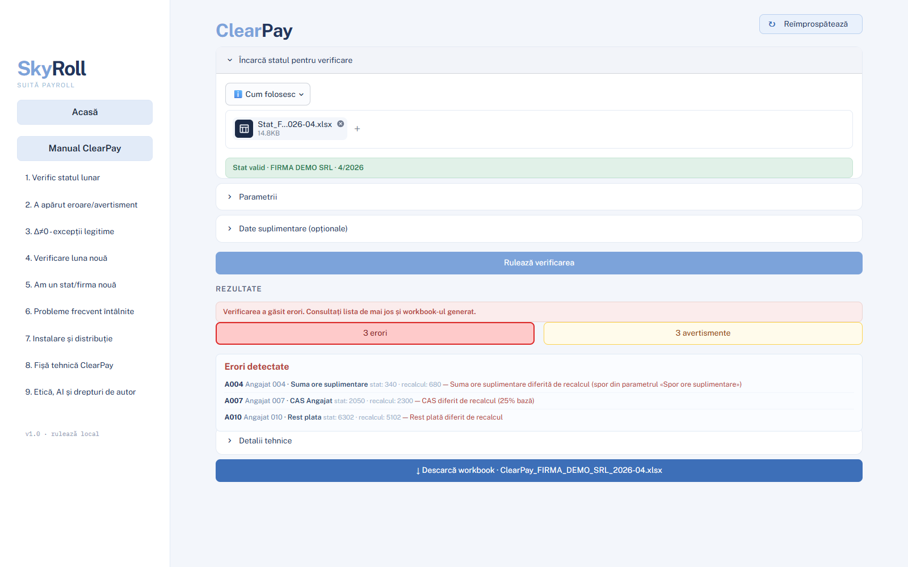
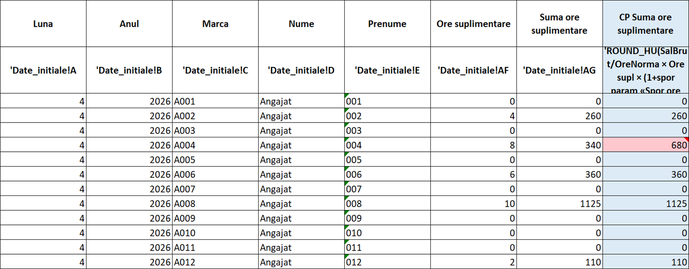
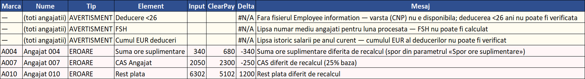

# SkyRoll — payroll verification, catalog-driven

[](https://github.com/Mihai-Streanga/SkyRoll-public/actions/workflows/tests.yml)

SkyRoll prepares, checks and refines a monthly payroll. It takes over the mechanical,
repetitive checking of a payroll statement and leaves the decisions, and the responsibility,
with the payroll specialist. It does not replace the specialist, and it does not replace the
system that produces the statements.

It is the first project of the [Streanga Method](https://github.com/Mihai-Streanga/streanga-method-for-claude):
designed by a payroll specialist in claude.ai, then built and maintained in Claude Code.

This repository is a **showcase**: the architecture, the design decisions, and a demonstration
engine that runs on synthetic data. The product itself (the full fiscal chain, the complete
catalog, the user interface) is private.

## The problem

A Romanian payroll statement has a couple of hundred columns per employee: hours, premiums,
benefits, contributions, tax, deductions, payout. Checking it by hand means recomputing a long
chain of dependent amounts for every employee, every month. The mistakes that slip through are
rarely in the totals; they sit in one cell of one employee: an overtime premium left out, a
contribution computed on the wrong base, an advance not deducted.

SkyRoll recomputes every cell on its own, compares it with the statement, and writes a workbook
in which every difference is marked and explained. The statement is never changed; the
specialist decides what to correct.

## What the private product does

- **285 catalogued elements**, each with its fiscal identity: how it is computed, what it
  depends on, its tolerance and rounding, and the message shown when it differs.
- **71 independent recalculations** per employee, in an order derived automatically from the
  dependencies the catalog declares.
- **A guard that refuses a bad statement before any calculation:** 49 fundamental columns must
  be present, and a statement read incompletely never produces a result.
- **A counterfactual reconciliation** for medical-leave averages, which separates a difference's
  cause from its consequences, so the specialist sees one finding instead of a cascade.
- **Onboarding without code:** a company with other columns enrols them as catalog entries,
  from the interface; the catalog learns.
- **410 automated tests**, written from the criteria already built into the engine, including
  statements broken on purpose to prove that the guards stop the run.
- **Private by design:** it runs on one machine, answers only on that machine, loads nothing
  from outside, and no AI model ever sees a real payroll register.

## Screenshots

The private product, run on a synthetic statement (invented company, invented employees):

| | |
|---|---|
|  |  |
|  |  |

The screenshots show the full product on its own synthetic statement (April 2026); the demo
below is a simplified engine that builds a different one (May 2026). Both find the same three
planted mistakes (A004, A007, A010), with different amounts.

## Run the demo

Tested with Python 3.14.

```
pip install -r requirements.txt
python -m skyroll_demo        # writes demo_output/SkyRoll_demo.xlsx
python -m pytest -q           # 50 tests, synthetic data only
```

The demo builds a statement for 12 invented employees of an invented company, with **three
mistakes planted on purpose**, checks it, and writes the workbook:

```
Findings: 3
  A004 · Suma ore suplimentare: statement 340, recalculated 595 — Overtime pay differs from rate x hours x (1 + overtime premium)
  A007 · CAS Angajat: statement 2050, recalculated 2300 — Pension contribution differs from rate x gross income
  A010 · Rest plata: statement 6375, recalculated 5175 — Payout differs from net salary minus deductions
Planted: 3 · found: 3 · missed: 0 · unexpected: 0
Written-file checks: all 7 passed
```

Other runs:

```
python -m skyroll_demo --clean                       # no planted mistakes: 0 findings
python -m skyroll_demo --drop-column "Ore Lucrate"   # the guard refuses; nothing is calculated
```

The demo computes gross income, the two employee contributions, a flat income tax, net salary
and payout, which is enough to show the architecture at work. The full fiscal chain of the
private product adds personal deductions, the minimum-wage rules, medical and annual leave
averages, tax exemptions, the disability solidarity fund (FSH) and benefit ceilings in EUR.

Element names stay in Romanian, as they appear on a Romanian payroll statement
(*Salariu brut* = gross salary, *Rest plata* = payout, *Marca* = employee ID).

## Architecture in one picture

```
statement (.xlsx) ──> guard ──> catalog-driven recalculation ──> workbook ──> written-file checks
                        │            │          │
                     refuses      catalog   parameters
                   before any    (what is   (which values,
                   calculation   computed)   from when)
```

| Module | Role |
|---|---|
| `skyroll_demo/catalog.py` | loads and validates the catalog; derives dependencies; dependency order; safe onboarding write |
| `skyroll_demo/parametri.py` | parameter store with validity intervals |
| `skyroll_demo/stat.py` | reads the statement; the employee ID as a text key |
| `skyroll_demo/gardian.py` | the compliance guard |
| `skyroll_demo/comportamente.py` | one function per behaviour |
| `skyroll_demo/recalcul.py` | recalculation and comparison, cell by cell |
| `skyroll_demo/scrie.py` | the output workbook, values only |
| `skyroll_demo/valideaza.py` | checks on the workbook as written to disk |
| `skyroll_demo/sintetic.py` | the synthetic statement and its planted mistakes |
| `exemple/catalog_exemplu.json` | 20 generic elements |
| `exemple/parametri_exemplu.json` | public legal rates and one illustrative value |

## Design principles

- **Autonomy** — runs on one machine, with no server, account or network; the result does not
  depend on who runs it.
- **Determinism** — the same statement gives the same workbook, every time; nothing in the
  calculation depends on iteration order or on a model's judgement.
- **Efficiency** — the specialist reads only the differences; every check is code, not
  attention.
- **Adaptability** — a company with other columns needs catalog entries, not code changes.
- **Integrability** — it takes the payroll system's export as it is and returns a plain
  workbook any spreadsheet program can open.

The reasoning behind each, and the rest of the design, is in [docs/DESIGN.md](docs/DESIGN.md).

## How it was built

SkyRoll was designed by a payroll specialist in claude.ai and then built with Claude Code,
under written rules: the agent proposes and writes code, deterministic code does every
calculation, the specialist decides. It was the first project of the
[Streanga Method](https://github.com/Mihai-Streanga/streanga-method-for-claude), and much of the
method grew out of it: deciding verification area by area, and six of the twenty verification
patterns in the method's catalogue, among them independent recalculation, numbered guards that
stop a run and counterfactual reconciliation. How the collaboration is organised day to day is
described in [docs/WORKING_WITH_AI.md](docs/WORKING_WITH_AI.md).

The history here is short because this repository is a showcase: the demo engine was written for
it, and the product stays in a private repository with its full history: 333 commits, from June to
October 2026 (read on 10 October 2026).

## License

© 2026 Mihai Streanga. All rights reserved. Source shown for portfolio purposes.
